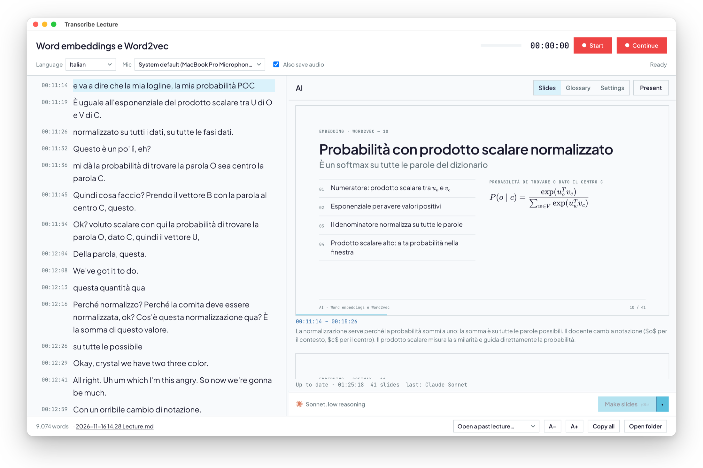

# Transcribe Lecture

A macOS app that transcribes lectures live, on your Mac, and turns what was said into slides you can study from.



- **Live transcription on the Mac.** It uses NVIDIA's Parakeet V3 speech model (25 European languages; GGUF, via [`transcribe-cpp`](https://crates.io/crates/transcribe-cpp)) on the GPU with Metal. Audio never leaves the computer.
- **Slides on demand.** Press **Make slides** whenever you like, and everything said since the last time becomes slides. They can hold diagrams, tables, plots, formulas (LaTeX), pseudocode and code. Claude Code makes them, on your Claude subscription, with the model and reasoning effort you choose.
- **Faithful to the lecture.** Slides contain only what the lecturer said. Commands, numbers or code that can't be found in the transcript are marked "(?)".
- **Your language, your look.** Choose the slides' language, and pick a theme or have Claude Code design one from a description.

> **Ask before you record.** Many universities and countries require the lecturer's permission to record a lecture, even for personal study. Transcripts and audio stay on your Mac, but it is your responsibility to have that permission.

## Requirements

- macOS 13 or later. Apple Silicon is recommended (Metal).
- The speech model, Parakeet V3 0.6B. The setup page downloads it on first launch: 740 MB from [Hugging Face](https://huggingface.co/handy-computer/parakeet-tdt-0.6b-v3-gguf), licence CC-BY-4.0, checked against its SHA-256. A copy that [Handy](https://handy.computer) or the Hugging Face cache already has is used instead.
- For slides: [Claude Code](https://docs.claude.com/en/docs/claude-code), logged in once with `claude` in Terminal, and a Claude subscription (Pro or Max).

## Build

You need Rust 1.85 or later and the Xcode Command Line Tools.

```sh
./bundle.sh             # builds target/Transcribe Lecture.app
./bundle.sh --install   # also copies it to ~/Applications
```

The app is signed ad hoc, so it runs only on the Mac that built it. Set `SIGN_IDENTITY` to sign it with your Developer ID. If the linker can't read the newest macOS SDK, set `SDKROOT` to an older one.

## Using it

On first launch a short setup walks you through it: downloading the speech model, testing the microphone, checking Claude Code, and choosing the course, languages and theme. You can open it again from **Settings → Open setup**.

1. Pick the lecture's language and the microphone. Type a title if you like, then press **Start** (⌘↩).
2. The transcript fills the left side as each sentence ends. It is saved continuously to `~/Documents/Lecture Transcripts/<date> <title>.md`, so a crash loses nothing. Tick **Also save audio** to keep a `.wav` next to it.
3. On the right, type the course name at the top. Press **Make slides** (⇧⌘↩) at the bottom whenever you want. Its **▾** menu sets the Claude model and reasoning (Low is fast; Rebuild deck and Review cards always use at least High) and holds the other slide tools. Click a slide's time range to jump to that part of the transcript.
4. **Present** opens the deck in your browser: press P to present, use ← → to move, and ⌘P to print a PDF.
5. Open a past lecture from the menu at the bottom to read it, make slides for it, or press **Continue** to record more into it.

The deck is saved next to the transcript as `<lecture> · Slide.json` and `<lecture> · Slide.html`.

### Slide tools

Rebuild deck, Review cards and Undo last are in the **▾** menu next to Make slides. Glossary and Settings are tabs at the top of the slide panel.


- **Rebuild deck** makes the whole deck again from the full lecture, more carefully.
- **Review cards** adds 6–12 exam-style questions at the end. The answers stay hidden until you click them.
- **Undo last** removes what the last click added.
- **Glossary.** Speech models mishear technical terms, and Parakeet can't be given a word list. So each time slides are made, the model also reports misheard words ("HCB" → "DHCP") and the course's key terms. They're saved per course and fixed live in later transcripts. Remove a wrong entry with ×.
- **PDFs.** Add the course's PDFs, and the model searches them to spell terms right and to point you to pages ("Material: «Lab3.pdf» p. 4"). It never adds content from them. Text is extracted on the Mac with PDFKit. Scanned PDFs without a text layer aren't supported.

### Settings

- **Slide language.** This sets the language of slides, notes and review cards. By default it follows the lecture's language, so you can transcribe a lecture in one language and study it in another.
- **Theme.** Themes set the colours and fonts of the slides, the exported decks and the app window, in light and dark mode.
  - A theme is a small CSS file in `~/Library/Application Support/Transcribe Lecture/themes/` that overrides the tokens in [`src/theme/default.css`](src/theme/default.css).
  - **New theme with Claude Code:** describe what you want, such as "navy and gold like my university's site example.edu, serif titles", and Claude Code writes the theme. It can read a website you name to take its colours.
  - From Terminal: `transcribe-lecture --make-theme "My university" "navy and gold, serif titles"`.
  - You can also edit a theme file by hand, or drop in your own.

## Privacy

- Audio and transcription stay on your Mac.
- When you make slides, the transcript is sent to Anthropic through Claude Code. If the course has PDFs, the pages the model looks up are sent too.
- Claude Code runs in an empty temporary folder, without your own Claude Code settings, tools, MCP servers or `CLAUDE.md`. It uses your subscription, never an `ANTHROPIC_API_KEY` from the environment.

## Files

| What | Where |
|---|---|
| Transcripts, audio, decks | `~/Documents/Lecture Transcripts/` |
| Settings, themes, speech model, glossaries, course PDFs (text) | `~/Library/Application Support/Transcribe Lecture/` |

## Command line

The binary is `target/release/transcribe-lecture` (or `Transcribe Lecture.app/Contents/MacOS/transcribe-lecture`):

```sh
transcribe-lecture --slides lecture.md [--course "Networks"] [--lang it] [--rebuild | --review] [--model opus] [--effort high]
transcribe-lecture --add-pdf notes.pdf --course "Networks"
transcribe-lecture --make-theme "Name" "description" [--model opus]
transcribe-lecture --download-model
transcribe-lecture --simulate audio.wav [--model path.gguf] [--lang it] [--speed 4] [--continue lecture.md]
```

`--simulate` transcribes a WAV file as if it were the microphone and writes the result to a temporary folder.

## Contributing

Read [AGENTS.md](AGENTS.md) for the code map, the file formats other code depends on, and how to test. It is written for AI coding agents and works just as well for people.

## License

Dual-licensed under [MIT](LICENSE-MIT) or [Apache-2.0](LICENSE-APACHE), at your option. KaTeX (`src/katex/`) is MIT-licensed; see [its license](src/katex/LICENSE). The Claude symbol (`src/claude-symbol.svg`, from [Wikimedia Commons](https://commons.wikimedia.org/wiki/File:Claude_AI_symbol.svg), CC0) is a trademark of Anthropic and is used only to show that slides are made by Claude. This project is not affiliated with or endorsed by Anthropic.
